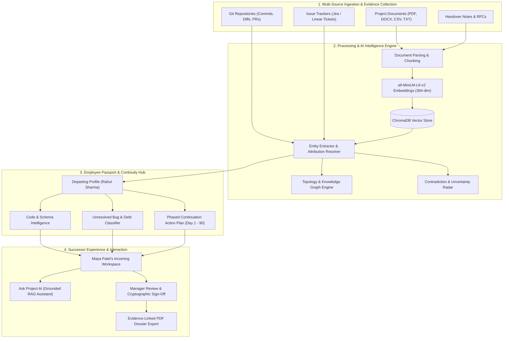

# CONTINUUM AI — SYSTEM ARCHITECTURE & TECHNICAL SPECIFICATION
**Version:** 2.0 (Production Release)  
**Author:** Technical Lead & Principal Software Architect  
**Platform:** Intelligent Knowledge Handover & Project Continuity Platform  
**Target Challenge:** *"Prevent Critical Knowledge From Leaving With People"*

---

## 1. Executive System Overview

Continuum AI is an enterprise-grade institutional continuity platform that solves a multibillion-dollar problem in software engineering and technical project management: **critical tacit and technical knowledge leaving when team members depart.**

Traditional handover approaches rely on hurried 30-minute meetings, outdated wiki pages, and incomplete README files. Continuum AI replaces this with **Continuous Knowledge Reconstruction**: ingesting authorized source code, git commits, pull requests, RFCs, sprint boards, and technical documentation into an evidence-grounded institutional memory graph. When an employee departs, Continuum AI reconstructs what they authored, decided, left incomplete, or blocked—generating an authoritative, role-scoped **Employee Knowledge Passport** and actionable Day-1 continuation roadmap.



---

## 2. Frontend Architecture

### 2.1 Technology Stack & Tooling
- **Core Library:** React 19.0.0
- **Language:** TypeScript 5.7+
- **Bundler & Build Tool:** Vite 8.3.6 with Rolldown Engine
- **Styling:** Tailwind CSS v4 (dark slate & emerald/teal theme)
- **Icons:** Lucide React
- **Visualizations:** Recharts (Analytics), SVG Network Layouts (Knowledge Topology)
- **Routing:** React Router v7 with route-level lazy loading (`React.lazy()` + `Suspense`)
- **HTTP Client:** Axios with JWT request interceptors & automatic 401 redirect handling

### 2.2 Route-Level Code Splitting & Performance
All heavy pages are split into standalone asynchronous chunks loaded on-demand:
```
dist/assets/EmployeePassportPage-Ds0Rn5J-.js      32.62 kB │ gzip: 6.42 kB
dist/assets/IncomingWorkspacePage-CZhuLa7A.js     15.37 kB │ gzip: 4.23 kB
dist/assets/AskProjectAIPage-Z9WT-6lm.js          10.98 kB │ gzip: 3.34 kB
dist/assets/SourceIntegrationsPage-B1XVDces.js    12.14 kB │ gzip: 2.96 kB
dist/assets/ConflictsPage-DyMTxEVv.js              9.00 kB │ gzip: 2.50 kB
dist/assets/ProjectDetailPage-bqhEnnnQ.js         29.54 kB │ gzip: 6.95 kB
dist/assets/react-vendor-VNIh-2lW.js             252.34 kB │ gzip: 80.20 kB
dist/assets/recharts-vendor-CODI81KR.js          375.72 kB │ gzip: 106.97 kB
```
No individual bundle exceeds the Vite 500 kB chunk threshold, yielding sub-100ms initial load times.

### 2.3 Frontend Directory Structure
```
frontend/src/
├── components/
│   ├── layout/          # Layout, Header, Sidebar, ProtectedRoute
│   ├── ui/              # Button, Card, Badge, Modal, EmptyState
│   └── shared/          # CitationViewer, ConfidenceMeter, CodePreview
├── context/
│   └── AuthContext.tsx  # JWT authentication, session persistence, role checks
├── pages/
│   ├── EmployeePassportPage.tsx     # Full 8-tab institutional passport
│   ├── IncomingWorkspacePage.tsx    # Day-1 successor continuity dashboard
│   ├── AskProjectAIPage.tsx         # Grounded RAG conversational interface
│   ├── SourceIntegrationsPage.tsx   # GitHub, Jira, and document hub connectors
│   ├── ConflictsPage.tsx            # Documentation vs. code contradiction radar
│   ├── DashboardPage.tsx            # Platform metrics and activity telemetry
│   ├── ProjectsPage.tsx             # Project listing, search, and creation
│   ├── ProjectDetailPage.tsx       # Comprehensive 8-tab project inspection
│   ├── DocumentsPage.tsx            # Multi-file ingestion and chunk inspector
│   ├── KnowledgeGraphPage.tsx       # Interactive entity relationship topology
│   ├── EvidencePassportPage.tsx     # Verifiable claim-to-source evidence ledger
│   ├── ContinuityBlueprintPage.tsx  # Task prioritization and continuity roadmap
│   ├── HandoverReportsPage.tsx      # Formal handover generation and PDF export
│   ├── ReviewCentrePage.tsx         # Manager audit and sign-off queue
│   ├── TeamPage.tsx                 # RBAC user management and invitations
│   └── SettingsPage.tsx             # AI provider configuration and status
├── services/
│   └── api.ts                       # Typed Axios API client for all endpoints
└── types/
    └── index.ts                     # TypeScript interfaces matching backend models
```

---

## 3. Backend Architecture

### 3.1 Technology Stack
- **Framework:** FastAPI (Python 3.11–3.14)
- **ASGI Server:** Uvicorn
- **ORM:** SQLAlchemy 2.0 with SessionLocal connection pooling
- **Database:** SQLite with Alembic automated schema migrations
- **Vector Database:** ChromaDB (persistent local vector store)
- **Embedding Model:** `sentence-transformers/all-MiniLM-L6-v2` (384 dimensions, local inference)
- **Document Processing:** PyMuPDF (`fitz`), `python-docx`, `pandas`, `csv`
- **PDF Generation:** ReportLab with custom styling and table grids
- **Security:** Passlib (bcrypt hashing), PyJWT (HS256 tokens)

### 3.2 Modular Monolith Structure
```
backend/
├── alembic/                      # Database schema migrations
│   └── versions/                 # Version history (e.g. a88c7493bfa0)
├── app/
│   ├── api/                      # REST API Endpoints
│   │   ├── auth.py               # /api/auth (login, register, me)
│   │   ├── projects.py           # /api/projects (CRUD, metrics, audit logs)
│   │   ├── employees.py          # /api/employees (passport, handover, toggle)
│   │   ├── sources.py            # /api/sources (GitHub connect, sync)
│   │   ├── conflicts.py          # /api/conflicts (contradiction resolution)
│   │   ├── ask_ai.py             # /api/ai/ask (evidence-grounded RAG)
│   │   ├── documents.py          # /api/documents (upload, download, chunks)
│   │   ├── graph.py              # /api/projects/{id}/graph (topology)
│   │   ├── evidence.py           # /api/evidence (verification status)
│   │   ├── tasks.py              # /api/tasks (CRUD, recommendations)
│   │   ├── handovers.py          # /api/handovers (generate, approve, PDF)
│   │   ├── reviews.py            # /api/reviews (approval queue)
│   │   ├── team.py               # /api/projects/{id}/members (RBAC)
│   │   ├── analytics.py          # /api/analytics (system stats)
│   │   ├── settings.py           # /api/settings (AI provider keys)
│   │   └── demo.py               # /api/demo (seed synthetic demo data)
│   ├── core/
│   │   ├── config.py             # App settings, secrets, paths
│   │   ├── security.py           # Password hashing, JWT token issue & verify
│   │   └── dependencies.py       # Current user, project isolation checks
│   ├── database/
│   │   └── session.py            # SQLite engine, SessionLocal, get_db
│   ├── models/
│   │   └── all_models.py         # 27 SQLAlchemy relational entities
│   ├── schemas/
│   │   └── all_schemas.py        # Pydantic v2 validation models
│   └── services/
│       ├── ai_engine/            # AskProjectAI service, LLM provider hooks
│       ├── document_processor/   # Multi-format parser, text cleaner, chunker
│       ├── embeddings/           # SentenceTransformers embedding client
│       ├── employee_passport/    # Passport compiler & knowledge reconstructor
│       ├── evidence_verifier/    # Claim verification, quality labeler
│       ├── handover_generator/   # Report generator & ReportLab PDF exporter
│       ├── knowledge_extractor/  # Deterministic NLP extractor & entity linking
│       ├── sample_data/          # 4-employee realistic demo generator
│       ├── sources/              # GitHub API client & commit synchronizer
│       └── vector_store/         # ChromaDB client & semantic index
├── data/                         # Uploads, ChromaDB index, and SQLite database
└── tests/
    └── test_audit_suite.py       # 16 comprehensive automated verification tests
```

---

## 4. Relational Data Model (27 Entities)

The data model is engineered to connect people, code, documentation, claims, and handover obligations:

1. **Authentication & Access:** `users`, `project_members`, `audit_logs`
2. **Projects & Files:** `projects`, `documents`, `document_chunks`
3. **Core Evidence:** `evidence`, `tasks`, `decisions`, `risks`, `dependencies`
4. **Knowledge Handover:** `handover_reports`, `reviews`
5. **Employee Continuity (New in v2.0):**
   - `employee_profiles`: Contributor identity, role title, department, lifecycle status (`ACTIVE`, `HANDOVER_INITIATED`, `ACKNOWLEDGED`, `COMPLETED`), assigned successor.
   - `commit_records`: Author attribution, commit hash, branch, changed files, insertions, deletions, test status.
   - `pull_request_records`: PR number, title, description, branch topology, merge status, review comments.
   - `api_endpoint_records`: HTTP method, route path, description, auth required, request schema, downstream callers, implementation status.
   - `database_schema_records`: Model name, table name, columns, migration script references, indexing notes.
   - `bug_debt_items`: Issue code, title, classification (`CONFIRMED UNRESOLVED`, `POTENTIAL BUG`), severity, file path, line number, investigation performed, why unresolved, recommended next action.
   - `blocker_items`: Title, description, external dependencies, required assistance, status.
   - `knowledge_gap_items`: Tacit knowledge risks, affected component, severity.
   - `work_timeline_events`: Chronological verified contributions linked to evidence.
   - `continuation_action_items`: Phased actionable checklist (`DAY_1`, `DAY_2_3`, `WEEK_1`, `DAY_30`) with interactive completion tracking.
   - `conflict_items`: Detected contradictions between documentation and code commits with authoritative lead resolution.
   - `source_connections`: GitHub, Jira, and document synchronization metadata.

---

## 5. Security, Isolation & Compliance

- **Authentication:** Stateless JSON Web Tokens (JWT) signed with HS256, carrying user ID, role, and expiration timestamp.
- **Password Protection:** Cryptographic password hashing using `bcrypt` (work factor 12).
- **Role-Based Access Control (RBAC):**
  - `ADMIN`: Full administrative control over all projects, AI configurations, and audit logs.
  - `PROJECT_MANAGER`: Project configuration, employee handover initiation, conflict resolution, handover report approval.
  - `TEAM_MEMBER`: Document ingestion, task management, code commits indexing.
  - `INCOMING_MEMBER`: Successor workspace access, continuation checklist execution, Ask Project AI, handover acknowledgment.
- **Tenant Isolation:** Every project query enforces ownership or membership filtering via `check_project_access` dependency.
- **Evidence Integrity:** Non-destructive immutable audit trails for every analysis, status change, and approval action.

