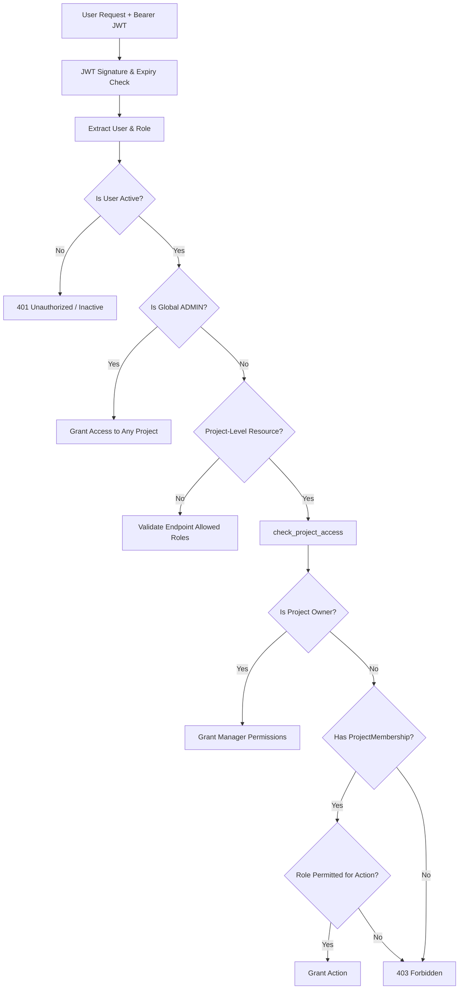

# CONTINUUM AI — AUTHENTICATION & AUTHORIZATION SPECIFICATION
**Identity, Access Management & Tenant Isolation Architecture**  
**Version:** 2.1.0  
**Target:** Engineering, DevOps & Security Reviewers

---

## 1. Identity & Role Hierarchy

Continuum AI implements Role-Based Access Control (RBAC) coupled with multi-tenant Project Isolation. Every authenticated request is authorized against the caller's global system role and their relationship to the target project.



### 1.1 Role Definitions

| Role | Scope | Key Permissions & Constraints |
|---|---|---|
| **`ADMIN`** | System-Wide | Full administrative control across all platform projects, global settings, AI engine configuration, user management, and system-wide audit logs (`/api/projects/audit-logs/all`). |
| **`PROJECT_MANAGER`** | Project-Level | Can create projects, invite team members, assign outgoing/incoming successors, review and approve/reject handover reports, connect source repositories, and resolve artifact conflicts. |
| **`TEAM_MEMBER`** | Project-Level | Contributing developer. Can create/edit tasks, upload authorized project documentation, trigger knowledge reconstruction, query project AI, and contribute code artifacts. |
| **`INCOMING_MEMBER`** | Project-Level | Transitioning successor. Read-only permissions on project knowledge. Restricted from mutating project tasks, initiating reconstruction, or viewing unapproved/draft handover reports. Can only inspect **APPROVED** handover reports and evidence passports. |

---

## 2. Authentication Architecture

### 2.1 Token Pair Strategy

| Token Type | Purpose | Expiry | Storage Recommendation | Properties |
|---|---|---|---|---|
| **Access Token** | Stateless API authorization | 30 minutes | Frontend memory | Contains `sub` (user ID), `role`, `iat`, `exp`, `jti`. Signed with HMAC-SHA256. |
| **Refresh Token** | Session renewal & rotation | 7 days | HttpOnly Secure Cookie or Encrypted Storage | Opaque random token wrapped in JWT. SHA-256 hash stored in `user_sessions` table. Rotated on every use. |

### 2.2 Password Policy & Hashing
- **Algorithm:** `bcrypt` with work factor 12.
- **Length Constraints:** Minimum 8 characters, maximum 128 characters (prevents Algorithmic Complexity / bcrypt DoS attacks).
- **Complexity Requirements:** Must contain at least one uppercase letter `[A-Z]`, one lowercase letter `[a-z]`, and at least one digit or symbol `[!@#$%^&*()_+-=...]`.

### 2.3 Brute-Force & Account Lockout
- Failed login attempts are recorded in the `login_attempts` table.
- If **5 failed attempts** occur for a given email address within a **15-minute sliding window**, subsequent authentication attempts return:
  `HTTP 429 Too Many Requests: Account temporarily locked due to multiple failed login attempts. Please try again after 15 minutes.`
- Prevents password guessing and credential stuffing attacks.

---

## 3. Authentication Endpoints & Lifecycles

### 3.1 Public User Registration
- **`POST /api/auth/register`**
- **Privilege Boundary:** Public registration can ONLY create `TEAM_MEMBER` or `INCOMING_MEMBER` accounts. Supplying `ADMIN` or `PROJECT_MANAGER` in public registration is rejected and safely downgraded to `TEAM_MEMBER`.

```json
// Request Body
{
  "name": "Elena Rostova",
  "email": "elena.rostova@continuum.ai",
  "password": "SecurePassword2025!",
  "role": "TEAM_MEMBER"
}

// Response (201 Created)
{
  "access_token": "eyJhbGciOiJIUzI1NiIsInR5cCI6IkpXVCJ9...",
  "refresh_token": "eyJhbGciOiJIUzI1NiIsInR5cCI6IkpXVCJ9...",
  "token_type": "bearer",
  "user": {
    "id": 12,
    "name": "Elena Rostova",
    "email": "elena.rostova@continuum.ai",
    "role": "TEAM_MEMBER",
    "is_active": true
  }
}
```

### 3.2 Login with Device Tracking
- **`POST /api/auth/login`**
- Captures client IP and User-Agent, generates an active `UserSession` entry, and returns the token pair.

```json
// Request Body
{
  "email": "elena.rostova@continuum.ai",
  "password": "SecurePassword2025!"
}
```

### 3.3 Refresh Token Rotation
- **`POST /api/auth/refresh`**
- Verifies refresh token signature, checks if session has been revoked in database, invalidates old refresh token, and issues newly rotated token pair.

```json
// Request Body
{
  "refresh_token": "eyJhbGciOiJIUzI1NiIsInR5cCI6IkpXVCJ9..."
}

// Response (200 OK)
{
  "access_token": "<new_30m_access_token>",
  "refresh_token": "<new_7d_refresh_token>",
  "token_type": "bearer",
  "user": { ... }
}
```

### 3.4 Single-Device Logout vs. Multi-Device Logout
- **`POST /api/auth/logout`** — Revokes the current session's refresh token hash.
- **`POST /api/auth/logout-all`** — Invalidate all active sessions across all devices for the authenticated user.
- **`GET /api/auth/sessions`** — Lists active sessions with device name, IP address, and last used timestamp.
- **`DELETE /api/auth/sessions/{session_id}`** — Selectively revoke an individual remote device session.

### 3.5 Password Change & Reset
- **`POST /api/auth/change-password`** — Requires current password; revokes all other active sessions upon success.
- **`POST /api/auth/forgot-password`** — Emits single-use 15-minute token (hashed with SHA-256 before database storage). Always returns generic message to prevent email enumeration.
- **`POST /api/auth/reset-password`** — Consumes single-use token, resets password, and revokes all active sessions.

---

## 4. Tenant & Project Isolation Logic

Every resource router uses `check_project_access(project_id, current_user, db, allowed_roles=...)`:

```python
def check_project_access(project_id: int, user: User, db: Session, allowed_roles: Optional[List[str]] = None) -> Project:
    project = db.query(Project).filter(Project.id == project_id).first()
    if not project:
        raise HTTPException(status_code=404, detail="Project not found.")

    # 1. Global ADMIN has access across all projects
    if user.role == UserRole.ADMIN.value:
        return project

    # 2. Project Owner is granted Project Manager privileges
    if project.owner_id == user.id:
        # Check if action is strictly reserved for Global Admin
        if allowed_roles and UserRole.ADMIN.value in allowed_roles and len(allowed_roles) == 1:
            raise HTTPException(status_code=403, detail="Action restricted to global administrators.")
        return project

    # 3. Verify explicit project membership
    membership = db.query(ProjectMembership).filter(
        ProjectMembership.project_id == project.id,
        ProjectMembership.user_id == user.id
    ).first()

    if not membership:
        # Log unauthorized IDOR attempt
        db.add(AuditLog(user_id=user.id, project_id=project.id, action="ACCESS_DENIED_IDOR", ...))
        db.commit()
        raise HTTPException(status_code=403, detail="Access denied: You are not a member of this project.")

    # 4. Enforce role restrictions
    effective_role = membership.role or user.role
    if allowed_roles and effective_role not in allowed_roles:
        raise HTTPException(status_code=403, detail=f"Access denied: Requires role in {allowed_roles}.")

    return project
```

This guarantees zero data leakage across projects, preventing unauthorized users from accessing or modifying documents, tasks, employee passports, and handover blueprints.

