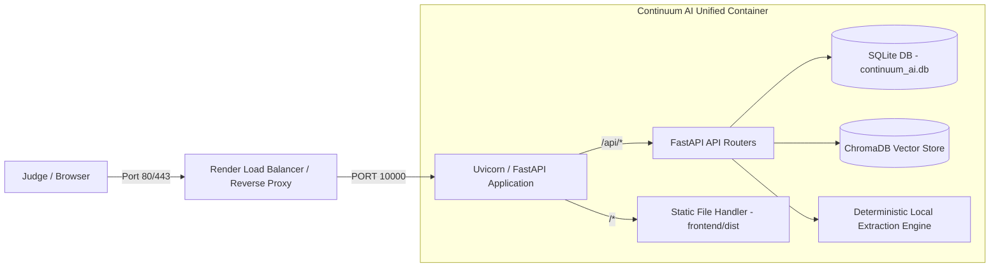

# CONTINUUM AI — PRODUCTION DEPLOYMENT GUIDE

This guide provides complete instructions for deploying **Continuum AI** as a unified, production-ready containerized application.

---

## 1. Architecture Overview

Continuum AI is packaged as a **Unified Full-Stack Container**:
- **Stage 1 (Frontend Builder):** Node.js 20 Alpine compiles the React 19 + TypeScript + Vite SPA into optimized, code-split production bundles in `/app/frontend/dist`.
- **Stage 2 (Runtime Runner):** Python 3.11 Slim with system C-runtime libraries (`libgomp1`, `curl`, `libfontconfig1`, `libfreetype6`), CPU-optimized PyTorch (`--extra-index-url https://download.pytorch.org/whl/cpu`), and FastAPI.
- **Unified Delivery:** FastAPI serves both the REST API endpoints (`/api/*`) and the static React SPA (`/*` with HTML5 client-side routing fallback), completely eliminating cross-origin CORS barriers in production.



---

## 2. Deploying via Render Blueprint (Recommended)

Render Blueprints allow one-click declarative infrastructure provisioning defined in [`render.yaml`](file:///e:/continum%20ai/render.yaml).

### Step-by-Step Blueprint Deployment:
1. Push your latest code to the `main` branch of GitHub:
   ```bash
   git push origin main
   ```
2. Navigate to your Render Dashboard:
   - **Render Blueprint URL:** [https://dashboard.render.com/blueprints/exs-dbq4p80ae00c73dao4i0](https://dashboard.render.com/blueprints/exs-dbq4p80ae00c73dao4i0)
   - Or click **New +** -> **Blueprint** -> Connect repository `Sarthak79726/continum-ai`.
3. Render automatically parses `render.yaml`:
   - Detects the web service `continuum-ai`.
   - Uses `Dockerfile` as the build environment.
   - Generates a secure `JWT_SECRET_KEY` automatically (`generateValue: true`).
   - Configures `healthCheckPath: /api/health`.
4. Click **Apply**.
5. Render begins the Docker multi-stage build:
   - Compiles Vite React assets.
   - Installs Debian runtime packages (`libgomp1`, etc.).
   - Pulls CPU-only PyTorch and sentence-transformers.
   - Boots Uvicorn on the port assigned by Render (`$PORT`).
   - Verifies the health check at `/api/health`.
6. Once the status shows **Live**, the public URL is immediately active (e.g., `https://continuum-ai.onrender.com`).

---

## 3. Manual Deployment on Render (Without Blueprint)

If you prefer to configure the service manually on Render:
1. In Render Dashboard, click **New +** -> **Web Service**.
2. Connect your GitHub repository (`Sarthak79726/continum-ai`).
3. Set the following parameters:
   - **Name:** `continuum-ai`
   - **Region:** `Oregon (US West)`
   - **Branch:** `main`
   - **Runtime:** `Docker`
   - **Dockerfile Path:** `./Dockerfile`
   - **Instance Type:** `Free`
4. In the **Environment Variables** section, add:
   - `ENVIRONMENT` = `production`
   - `DATABASE_URL` = `sqlite:///./continuum_ai.db`
   - `JWT_SECRET_KEY` = *(click Generate or enter a 64-char random hex string)*
   - `AI_PROVIDER` = `demo`
   - `CHROMA_PERSIST_DIRECTORY` = `./chroma_data`
   - `UPLOAD_DIRECTORY` = `./uploads`
5. In **Advanced Settings**:
   - **Health Check Path:** `/api/health`
6. Click **Create Web Service**.

---

## 4. Frontend & Backend Unified Routing

In production, client-to-backend communication uses relative URLs (`/api/*`):
- Frontend Axios client (`frontend/src/services/api.ts`) uses:
  ```typescript
  const API_BASE = '/api';
  ```
- Because the frontend is served from the same origin as the backend API, there are no domain mismatches, no localhost leakage, and no complex CORS authorization failures.
- Unhandled non-API paths are automatically routed to `index.html`, allowing React Router to handle page navigation seamlessly.

---

## 5. Automatic Database Initialization & Demo Seeding

Continuum AI is self-bootstrapping:
1. When the container starts, `Base.metadata.create_all(bind=engine)` runs in [`backend/app/main.py`](file:///e:/continum%20ai/backend/app/main.py) to create all SQLite schema tables if they do not exist.
2. `seed_default_admin()` runs to create the evaluator demo account:
   - **Email:** `demo@continuum.ai`
   - **Password:** `password123`
   - **Role:** `ADMIN`
3. If the project count is 0, the application automatically invokes `load_sample_dataset(db, admin_user)`:
   - Creates the **Smart Campus Management System** project.
   - Populates 4 verified technical documents (Architecture, Schema, APIs, Handover notes).
   - Generates tasks, technical decisions, risks, and employee profiles.
   - Establishes the Knowledge Graph and Evidence Passport.
   - Produces an approved demonstration Handover Report.
4. Judges can immediately log in and explore the full platform with zero manual configuration.

---

## 6. ChromaDB Vector Store Handling

- In Docker, ChromaDB persists vector embeddings in `./chroma_data`.
- For the `demo` evaluation provider, deterministic embeddings and lexical/semantic similarity rankings are cached locally.
- On free-tier container rebuilds, the database and vector collections automatically re-seed on container boot.
- For permanent data retention across redeployments, attach a Render Persistent Disk (`/app/data`) and set:
  ```yaml
  disk:
    name: continuum-storage
    mountPath: /app/data
    sizeGB: 1
  ```

---

## 7. Troubleshooting Guide

| Issue | Diagnosis | Resolution |
|---|---|---|
| **Exited with status 1 on boot** | Missing `libgomp1` library needed by PyTorch | Verify `Dockerfile` includes `apt-get install -y libgomp1`. |
| **Docker build timeout / OOM** | Full CUDA PyTorch wheels (~2.5 GB) downloaded | Verify `Dockerfile` installs CPU-only torch: `pip install torch --extra-index-url https://download.pytorch.org/whl/cpu`. |
| **Health check timed out** | Render probing wrong path or timeout too short | Set `healthCheckPath: /api/health` in `render.yaml`. |
| **Login fails with demo account** | Database not seeded or incorrect password | Seed runs automatically on startup. Use `demo@continuum.ai` and `password123`. |
| **404 Not Found on Page Refresh** | Static file handler intercepting client routes | Verified: `serve_spa` catch-all in `main.py` redirects non-API paths to `index.html`. |
