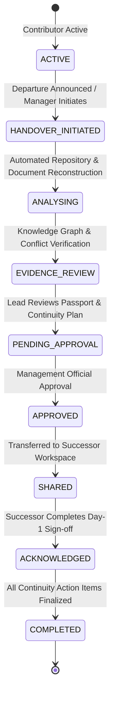

# CONTINUUM AI — EMPLOYEE KNOWLEDGE PASSPORT SPECIFICATION
**Standard:** Enterprise Institutional Memory & Knowledge Handover Standard  
**Version:** 2.0  
**Compliance Target:** ISO/IEC 27001 Evidence Grounding & Zero Knowledge Loss

---

## 1. What is the Employee Knowledge Passport?

The **Employee Knowledge Passport** is an authoritative, digitally signed institutional memory asset generated for departing software developers, architects, or team members. 

When an engineer leaves an organization, traditional handovers fail because up to 80% of their actual contribution exists as **tacit knowledge**—undocumented architectural assumptions, unmerged branches, temporary bug workarounds, database schema nuances, and pending technical debt.

The Employee Knowledge Passport reconstructs this hidden reality by analyzing:
1. **Source Code & Git Commits:** Code authored, files modified, lines added/deleted, branch history.
2. **Pull Requests & Code Reviews:** Design deliberations, rejected alternatives, unresolved comments.
3. **API Endpoints Authored:** Route contracts, payload schemas, auth guards, downstream consumer dependencies.
4. **Database Schemas & Migrations:** Tables created, primary/foreign keys, indexes, pending migration scripts.
5. **Defects & Technical Debt:** Known bugs, failed test cases, reproduction steps, why they were left unresolved, and recommended next fixes.
6. **Continuation Roadmap:** A day-by-day, phased takeover plan tailored for the successor.

---

## 2. Handover Lifecycle State Machine

### Lifecycle States Description:
1. **`ACTIVE`**: The employee is actively contributing code and documentation.
2. **`HANDOVER_INITIATED`**: Manager or lead triggers transition, designates incoming successor, and provides transition remarks.
3. **`ANALYSING`**: Continuum AI automatically parses all authorized repositories, commits, PRs, and project docs.
4. **`EVIDENCE_REVIEW`**: Contradictions between sprint tickets and code commits are flagged for human review.
5. **`PENDING_APPROVAL`**: Handover dossier is submitted to project lead or engineering manager.
6. **`APPROVED`**: Lead signs off on the scope, debts, and continuation tasks.
7. **`SHARED`**: Access is granted to the incoming developer's personal workspace.
8. **`ACKNOWLEDGED`**: Successor completes Day-1 review and signs digital handover receipt with timestamp.
9. **`COMPLETED`**: Phased continuation tasks through Week 1 and Day 30 are verified complete.

---

## 3. The 8 Core Sections of the Passport

### Section 1: Executive Overview & Contributor Profile
- Employee ID, full name, role title, department, date joined.
- Assigned successor with role title and contact.
- High-level scope of work and summary of key system areas owned.
- Real-time metrics: Total commits, PRs merged, APIs authored, active blockers, unresolved bug debt items.

### Section 2: Evidence-Verified Work Timeline
- Chronological timeline of technical events:
  - Commits merged to primary branches.
  - Architecture decisions registered in RFCs.
  - Pull requests reviewed and approved.
  - Bug fixes attempted and test failures recorded.
- Every timeline node includes a **verification status** badge (`VERIFIED`, `PARTIALLY_VERIFIED`, `UNVERIFIED`) linked to source hashes or document page numbers.

### Section 3: Code & GitHub Intelligence
- Direct synchronization with GitHub/GitLab:
  - Commit hash (clickable to repo commit view).
  - Commit messages, branches, diff metrics (+insertions / -deletions).
  - Modified files list with module impact mapping.
  - Pull request numbers, review summaries, linked ticket IDs (e.g. `CAMPUS-101`).

### Section 4: Authoritative API Endpoints Inventory
- Every endpoint authored or maintained by the departing employee:
  - **HTTP Method:** `GET`, `POST`, `PUT`, `DELETE`.
  - **Route Path:** (e.g. `/api/auth/token/revoke`, `/api/attendance/records/bulk`).
  - **Implementation Status:** `COMPLETED`, `PARTIALLY_IMPLEMENTED`, `NEEDS_TESTING`.
  - **Authentication Guards:** Required roles and bearer token requirements.
  - **Payload Schemas:** JSON request/response schema specifications.
  - **Downstream Consumers:** Frontend components, mobile apps, or internal microservices dependent on this endpoint.

### Section 5: Database & Storage Architecture
- Tables, schemas, and data pipelines created or modified:
  - Target table and ORM model name.
  - Column schema, data types, nullability, and primary/foreign keys.
  - Migration script filename (e.g. `alembic/versions/20261101_add_attendance.py`).
  - Known performance bottlenecks, indexing considerations, and data volume expectations.

### Section 6: Unresolved Bugs & Technical Debt Radar
Continuum AI classifies technical debt with surgical precision:
- **`CONFIRMED UNRESOLVED`**: Test suite fails or code comments explicitly acknowledge the defect.
- **`POTENTIAL BUG`**: Edge case without test coverage or unhandled error state.
- **`NEEDS INVESTIGATION`**: Intermittent failure or race condition under load.
- **Fields for Each Defect:**
  - Severity (`CRITICAL`, `HIGH`, `MEDIUM`, `LOW`).
  - Affected module, file path, and exact line number.
  - Summary of investigation already performed by departing engineer.
  - Why it is still unresolved (e.g., third-party timeout, library deprecation).
  - **Recommended Next Action:** Clear technical instructions for incoming successor.

### Section 7: Blockers & Tacit Knowledge Gaps
- **Active Blockers:** Pending external API keys, cross-team approvals, third-party infrastructure.
- **Tacit Knowledge Gaps:** AI-detected areas where an engineer was the sole committer or decision-maker with zero written documentation in the repository.

### Section 8: Successor Continuation Action Plan
A structured, phased checklist with interactive completion tracking:
- **Phase 1: Day 1 (Immediate Onboarding)**
  - Local repository clone, Docker Compose startup, environment variable configuration.
  - Reproduce known failing test cases in isolated dev environment.
- **Phase 2: Days 2–3 (Bug Resolution & Stabilization)**
  - Execute recommended fix for critical unresolved debt (e.g., Redis token blacklist).
  - Complete unfinished API endpoints and write unit tests.
- **Phase 3: Week 1 (Feature Integration & Deployment)**
  - Connect backend services to frontend views.
  - Run end-to-end integration test suite.
- **Phase 4: Day 30+ (Long-Term Architecture)**
  - Schema indexing optimizations, partitioning, microservice decoupling.

---

## 4. Case Study: Rahul Sharma → Maya Patel Transition

### The Scenario:
- **Departing Engineer:** Rahul Sharma (Lead Backend Developer).
- **Incoming Successor:** Maya Patel (Backend Developer).
- **Project:** Smart Campus Management & Access Control System.

### Reconstructed Deliverables:
1. **APIs Authored:**
   - `POST /api/auth/login` (Status: `COMPLETED`)
   - `POST /api/auth/token/revoke` (Status: `PARTIALLY_IMPLEMENTED` — Redis connection issue)
   - `POST /api/attendance/records/bulk` (Status: `COMPLETED` — requires batch chunking)
2. **Critical Debt Identified:**
   - **Bug:** `AUTH-ERR-401`: Token revocation blacklist fails under concurrent load due to Redis cluster connection drop.
   - **Location:** `backend/app/core/security.py:142`
   - **Why Unresolved:** Rahul ran out of time before sprint freeze; Redis retry policy not configured.
   - **Fix for Maya:** Configure `max_connections=50` and `retry_on_timeout=True` in Redis connection pool.
3. **Handover Sign-off:**
   - Maya opens the **Incoming Workspace**, reviews Rahul's Passport, asks questions via **Ask Project AI**, checks off Day-1 tasks, and records a cryptographically audited handover sign-off.

