# CONTINUUM AI — EVIDENCE GROUNDING & VERIFICATION ENGINE
**Standard:** ISO/IEC 27001 Evidence Integrity & Zero Hallucination Guarantee  
**Module:** `app.services.evidence_verifier.verifier`  
**Version:** 2.0  

---

## 1. Zero Hallucination Philosophy

In technical handover and institutional continuity, **an incorrect or hallucinated statement is worse than no statement at all.** If an incoming developer is falsely told that an authentication module is complete when its token revocation is failing under load, critical production outages and security vulnerabilities inevitably follow.

Continuum AI operates under strict **Evidence Grounding Rules**:
1. **No Claim Without a Source:** Every assertion in an Employee Knowledge Passport, Continuity Blueprint, or Handover Dossier must bind directly to an underlying evidence record (a git commit hash, a pull request diff, a document chunk, or an approved meeting transcript).
2. **Deterministic Extraction Over Blind Generation:** AI models are constrained by strict JSON schema extractors and deterministic semantic verifiers.
3. **Explicit Uncertainty & Missing Evidence Notices:** If information cannot be verified against repository sources, the system explicitly marks it as `UNVERIFIED` or generates a `Missing Evidence Notice` instead of guessing.

---

## 2. Evidence Architecture & Data Flow

```mermaid
flowchart TD
    RawArtifact["Raw Ingested Artifact (Document, Commit, Ticket)"] --> Chunker["Chunker & Preprocessor"]
    Chunker --> Embedder["all-MiniLM-L6-v2 (384-dim Embeddings)"]
    Embedder --> VectorDB[("ChromaDB Vector Store")]
    VectorDB --> Extractor["Claim & Entity Extractor"]
    Extractor --> Verifier["Evidence Verifier Service"]

    subgraph VerificationEngine["Verification & Conflict Detection"]
        GroundingCheck{"Is claim supported by exact source text?"}
        CrossSourceCheck{"Does code reality contradict document claim?"}
    end

    Verifier --> GroundingCheck
    GroundingCheck -- Yes --> Verified["VERIFIED (High Confidence)"]
    GroundingCheck -- Partial --> NeedsReview["NEEDS_REVIEW (Amber)"]
    GroundingCheck -- No --> Unverified["UNVERIFIED (Flagged)"]

    Verifier --> CrossSourceCheck
    CrossSourceCheck -- Contradiction --> ConflictRadar["CONFLICTING (Conflict Radar Item)"]
    CrossSourceCheck -- Consistent --> Verified

    ConflictRadar --> LeadReview["Authorized Lead Resolves Conflict with Justification"]
    LeadReview --> ImmutableAudit[("Immutable Audit Log")]
```



---

## 3. Verification Classifications

Every claim, task, decision, and bug in the system carries an immutable verification status:

| Status Badge | Semantic Meaning | System Behavior |
| :--- | :--- | :--- |
| **`VERIFIED`** | Supported by verbatim source quote or verified git commit. | Displayed with emerald badge; included in official PDF export. |
| **`NEEDS_REVIEW`** | Extracted from high-level meeting notes without explicit technical details. | Amber warning badge; prompts manager to validate before handover approval. |
| **`CONFLICTING`** | Two authorized project sources make contradictory statements. | Alert badge; routed to **Conflicts Radar** for lead resolution. |
| **`UNVERIFIED`** | Tacit knowledge mentioned verbally or inferred without written repository record. | Marked with slate pill; flagged in Ask Project AI as `INSUFFICIENT_EVIDENCE`. |

---

## 4. Conflict & Contradiction Radar

One of Continuum AI's most powerful capabilities is **cross-source contradiction detection**.

### Concrete Example:
- **Claim A (Sprint Board / Jira):** `CAMPUS-102: JWT Token Revocation` is marked as `Done & Deployed`.
- **Claim B (Git Commit Reality):** Commit `9f4e21a` by Rahul Sharma contains commit message: `WIP: Redis blacklist connection failing, unit test disabled`.
- **System Action:**
  1. Continuum AI flags this pair as a `DOCUMENTATION_VS_CODE` conflict.
  2. The conflict appears on the **Conflicts Radar** (`/conflicts`).
  3. The manager (Sarah Chen) or lead reviews both claims and submits an authoritative resolution:
     > *"Confirmed code reality: Redis cluster connectivity issue is still present. Re-opened CAMPUS-102 for Maya to resolve on Day 2."*
  4. The resolution is written to the audit log and injected into Maya's **Incoming Workspace** as an immediate priority.

---

## 5. API Reference for Evidence & Conflicts

### 5.1 Query Evidence for a Project
`GET /api/projects/{project_id}/evidence`

**Response:**
```json
[
  {
    "id": 1,
    "project_id": 1,
    "document_id": 1,
    "document_name": "project_overview.pdf",
    "chunk_id": 4,
    "claim_text": "Student & Staff Authentication Module: Fully completed using FastAPI JWT bearer tokens.",
    "source_snippet": "Authentication service is implemented using PyJWT and bcrypt with RBAC middleware.",
    "page_number": 2,
    "verification_status": "VERIFIED",
    "quality_label": "High Integrity",
    "created_at": "2026-11-10T12:00:00Z"
  }
]
```

### 5.2 Resolve a Contradiction
`POST /api/conflicts/{conflict_id}/resolve`

**Request Body:**
```json
{
  "resolution_notes": "Authoritative verdict: Redis connection is failing under load. Kept ticket open for incoming successor."
}
```

**Response:**
```json
{
  "id": 1,
  "resolution_status": "resolved",
  "resolved_by": "Demo Admin",
  "resolution_notes": "Authoritative verdict: Redis connection is failing under load. Kept ticket open for incoming successor."
}
```

