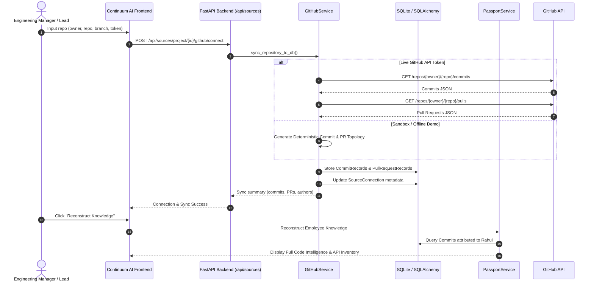

# CONTINUUM AI — SOURCE CODE & GITHUB INTEGRATION GUIDE
**Module:** `app.services.sources.github_service`  
**Purpose:** Automated Code History, Commit Attribution, and Pull Request Intelligence  
**Compliance Standard:** ISO/IEC 27001 Source Auditing

---

## 1. Overview

Continuum AI ingests code repositories directly into its institutional continuity graph. Instead of treating code merely as static text files or inspecting high-level metadata, the platform decomposes git commit histories, diffs, pull request comments, and branch topologies into **verifiable evidence artifacts**.

When an employee departs, Continuum AI reconstructs:
- Every commit authored by that developer across all branches.
- Lines of code added, deleted, and net churn by module.
- Pull requests authored, reviewed, or left open as drafts.
- Database migration files and ORM models introduced.
- Unresolved bugs documented in failing tests or commit commit messages (e.g. `WIP: Redis blacklist connection failing`).

---

## 2. Integration Architecture & Service Implementation

The integration service (`backend/app/services/sources/github_service.py`) operates in dual-mode:
1. **Live GitHub REST API Mode:** When a valid Personal Access Token or OAuth token is provided, it connects to `api.github.com/repos/{owner}/{repo}` to stream real-time commits, pull requests, and file diffs.
2. **Deterministic Synthetic Demo Fallback:** When evaluated offline, behind firewalls, or in hackathon sandboxes without live credentials, it deterministically synthesizes rich, realistic repository histories attributing commits and PRs to the 4-employee roster (`Rahul Sharma`, `Sarah Chen`, `Alex Kumar`, `Maya Patel`).



---

## 3. Data Models for Code Intelligence

### 3.1 `CommitRecord` Model
```python
class CommitRecord(Base):
    __tablename__ = "commit_records"

    id = Column(Integer, primary_key=True)
    project_id = Column(Integer, ForeignKey("projects.id", ondelete="CASCADE"), nullable=False)
    employee_id = Column(Integer, ForeignKey("employee_profiles.id", ondelete="CASCADE"), nullable=False)
    commit_hash = Column(String(40), nullable=False, index=True)
    message = Column(Text, nullable=False)
    branch = Column(String(100), default="main")
    changed_files = Column(JSON, default=list)  # List of file paths
    insertions = Column(Integer, default=0)
    deletions = Column(Integer, default=0)
    is_merged = Column(Boolean, default=True)
    has_tests = Column(Boolean, default=False)
    affected_modules = Column(JSON, default=list)  # ["Authentication", "Database"]
    timestamp = Column(String(50))
    source_url = Column(String(255), nullable=True)
```

### 3.2 `PullRequestRecord` Model
```python
class PullRequestRecord(Base):
    __tablename__ = "pull_request_records"

    id = Column(Integer, primary_key=True)
    project_id = Column(Integer, ForeignKey("projects.id", ondelete="CASCADE"), nullable=False)
    employee_id = Column(Integer, ForeignKey("employee_profiles.id", ondelete="CASCADE"), nullable=False)
    pr_number = Column(Integer, nullable=False)
    title = Column(String(255), nullable=False)
    description = Column(Text, nullable=True)
    source_branch = Column(String(100), nullable=False)
    target_branch = Column(String(100), default="main")
    is_merged = Column(Boolean, default=False)
    has_tests = Column(Boolean, default=False)
    open_review_comments = Column(Integer, default=0)
    review_notes = Column(Text, nullable=True)
    timestamp = Column(String(50))
    source_url = Column(String(255), nullable=True)
```

---

## 4. API Endpoints for Source Management

### 4.1 Connect a GitHub Repository
`POST /api/sources/project/{project_id}/github/connect`

**Request Body:**
```json
{
  "owner": "continuum-ai",
  "repo": "smart-campus-core",
  "branch": "main",
  "token": "ghp_optionalTokenHere"
}
```

**Response:**
```json
{
  "status": "success",
  "message": "Synchronized 8 commits and 3 pull requests for smart-campus-core",
  "connection_id": 1,
  "commits_synced": 8,
  "prs_synced": 3,
  "contributors_attributed": ["Rahul Sharma", "Sarah Chen", "Alex Kumar", "Maya Patel"]
}
```

### 4.2 Re-sync Active Repository
`POST /api/sources/project/{project_id}/github/sync`

Triggers an incremental delta fetch, indexing only commits merged since the previous sync timestamp.

---

## 5. Automated Knowledge Attribution Algorithm

1. **Author Resolution:** Matches git commit author email (`rahul.sharma@continuum.ai`, `rahul@campus.edu`) against `employee_profiles.name` and `user.email`.
2. **Module Classification:** Inspects changed file paths:
   - `backend/app/api/auth*` → Module: **Authentication**
   - `backend/app/models/*` or `alembic/*` → Module: **Database & Schema**
   - `backend/app/api/payments*` → Module: **Payment & Gateway**
   - `backend/tests/*` → Flags commit as `has_tests = True`
3. **Debt Extraction:** Analyzes commit messages matching patterns like `WIP:`, `FIXME:`, `TODO:`, or `broken:`, transforming them into tracked `BugDebtItem` entities requiring Day-1 successor review.

